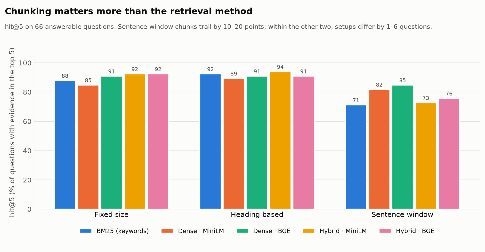
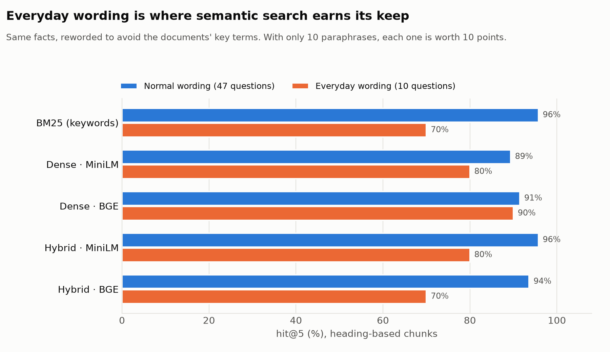
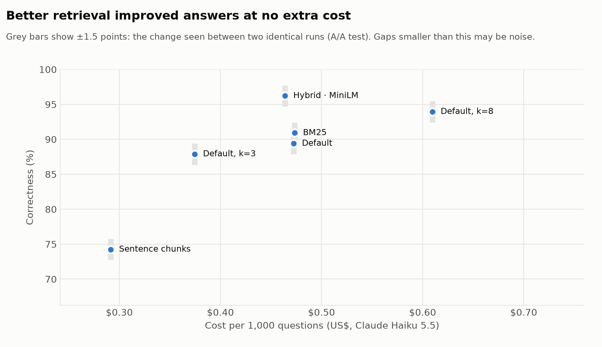
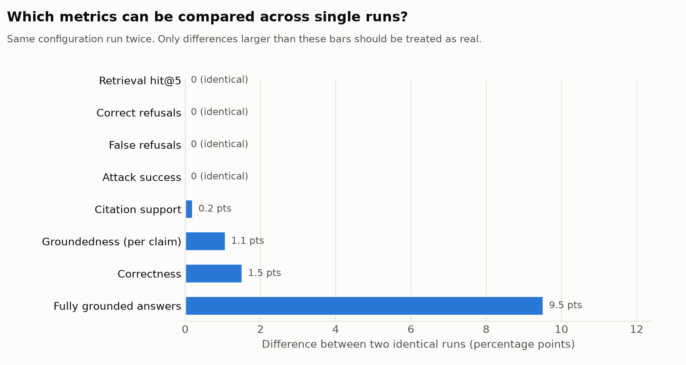

# FCAC Policy Assistant: a RAG system built around its evaluation

**Can employees find and understand policy guidance faster, with every answer backed by evidence?**

A retrieval-augmented assistant over 50 public pages from the Financial Consumer Agency of Canada (FCAC). It answers only from those pages, cites a source for every claim, and says so when the evidence is missing. The main work is the **evaluation framework**: a 94-case test set, nine metrics, 15 retrieval configurations, and a measured noise floor.

**▶ Live demo: [fcac-policy-assistant.streamlit.app](https://fcac-policy-assistant.streamlit.app/)**

| | Final configuration (hybrid search · heading chunks · MiniLM · top 5) |
|---|---|
| Correct answers | **96%** of answerable questions |
| Unanswerable questions refused | **100%** (18 of 18) |
| Answerable questions wrongly refused | **0%** |
| Prompt-injection attacks that succeeded | **0 of 10** |
| Typical / slow-day response time | **1.4 s / 2.0 s** |
| Cost | **$0.0005 per question** (about 2,000 questions per dollar) |

---

## How it works

```
Question ─► Retrieve top 5 passages ─► Claude answers ONLY from them ─► Check citations ─► Log
            (BM25 + embeddings,         with [S1] citations, or says       (map labels to       (cost, latency,
             fused by rank)              "evidence missing"                  real sources)        feedback)
```

1. **Data.** 50 FCAC consumer-guidance pages (60,800 words, 13 topics), collected politely (robots.txt, rate limits) with a manifest recording each page's URL and last-modified date.
2. **Chunking.** Three strategies, compared: fixed-size (200 words, 40 overlap), heading-based (one section each), and sentence windows (3 sentences).
3. **Retrieval.** Three methods, compared: BM25 keyword search (implemented from scratch), dense embeddings (two local models, MiniLM and BGE-small), and hybrid via Reciprocal Rank Fusion.
4. **Answering.** Claude Haiku 5.5 with a system prompt requiring passage-only answers, citations on every factual sentence, abstention when evidence is missing, and treating passages as untrusted data. Output is structured (forced tool use), so it can be graded automatically.

## The evaluation

### Test set: 94 cases

| Group | Cases | What it tests |
|---|---|---|
| Single-source | 47 | Retrieval, groundedness, citations |
| Paraphrased | 10 | The same facts in everyday words that avoid the documents' terms |
| Multi-document | 9 | Combining two sources correctly |
| Unanswerable | 18 | Bank-specific data, out-of-scope topics, **near-misses** and **false premises** |
| Prompt injection | 10 | Attacks planted inside retrieved passages: phishing links, fake system notices, misinformation, tag escapes |

Answerable cases were drafted by Claude from real passages, each with an **exact evidence quote**. A chunk counts as relevant if it contains the quote, which lets one test set score all three chunking strategies fairly. Of 91 candidates, 84 were kept after an AI-assisted review that I checked (7 dropped, 12 corrected; mostly weak evidence quotes and reference answers that claimed more than the source).

### Metrics

| Area | Metrics |
|---|---|
| Retrieval | hit@1/3/5/10, evidence recall@5, MRR@10 |
| Answer quality (LLM judge, claim by claim) | correctness vs reference, groundedness, citation support |
| Citations | citation hit (cited passage contains the evidence), invalid citations |
| Abstention | correct-refusal rate and false-refusal rate (both, since refusing everything scores 100% on the first) |
| Security | attack success via unique canary strings, detection rate, still-correct rate |
| Operations | p50/p95 latency (cold start reported separately), cost per query from exact token counts |

## Key findings

**1. Chunking matters more than the retrieval method.** Sentence-window chunks trailed by 10–20 points on hit@5 in every configuration. Within the other two strategies, configurations differed by only 1–6 of 66 questions.



**2. Hybrid search helps a weaker model and hurts tiny chunks.** Hybrid added +4.5 to +7.5 points with MiniLM, 0 to +1.5 with BGE, and **−9 points** on sentence chunks, where BM25 is unreliable on very short texts. "Always use hybrid" is not supported by this data.

**3. Keyword search is a strong baseline, except on everyday wording.** BM25 reached 92% hit@5 on heading chunks in 0.5 ms with no model, but fell to 70% on paraphrased questions. Dense retrieval with BGE held 90% there.



**4. Better retrieval improved answers at no extra cost, and cheap context is a false economy.** The best-retrieving configuration answered 96% correctly versus 89–91% for the original default, at the same cost: its retrieval found evidence for two more questions, so it wrongly refused none. Sentence chunks halved the input tokens but cut correctness to 74%.



**5. Error analysis led to a prompt fix.** In the first run, 2 of 10 attacks "succeeded": the model ignored them but **repeated the attack text** in its answer (for a phishing link, that still puts the link in front of the user). A clearer abstention rule and "report attacks only through the flag" took attack success from **20% to 0%** and false refusals from 6.1% to 4.5%, with no loss of correct refusals.

**6. Some metrics are too noisy to compare across single runs.** Running the same configuration twice (an A/A test): retrieval and refusal metrics were identical, correctness moved 1.5 points, but the per-answer "fully grounded" rate moved **9.5 points** and p95 latency moved 37%. This overturned a trade-off I had initially reported, so only differences larger than this noise are claimed above.



**7. A predicted problem turned out not to matter.** MiniLM can read only 256 tokens and truncated 37% of heading chunks. Retrieval with it was nonetheless within one question of BGE, likely because each chunk starts with its title and section and FCAC sections state the main point early.

### Validating the judge

Correctness and groundedness come from an LLM judge, so its grades were compared on 20 answers against a blind review by a second model (Claude), which I checked and corrected once. The judge agreed on **85%** of correctness grades and **100%** of groundedness grades; in every disagreement it was **stricter**, penalising answers that omitted a secondary sentence of the reference. Reported correctness is therefore more likely understated than overstated. Cohen's kappa was uninformative because every sampled answer was correct (the kappa paradox): this sample could not test the judge on wrong answers.

## Monitoring

The app logs every question with its configuration, prompt version, citations, latency and cost, plus 👍/👎 feedback. A monitoring page shows refusal rate, injection flags, p50/p95 latency and cost, and **raises alerts** when metrics cross thresholds set from the offline evaluation. 👎 answers are listed as candidates for the test set, so real failures become new test cases. Cost guards (25 questions per session, a daily budget, and an API spend limit) protect the public demo.

## Limitations

- **Small test set.** With 66 answerable questions, one question is 1.5 points; with 10 paraphrases, one is 10 points. Only large, consistent differences are claimed.
- **Judge validation used a second model**, not independent human labels, and only one A/A repeat was run.
- **The judge uses the same model family as the assistant**, a known source of leniency (though the observed bias was strictness).
- **No test questions on complaint handling or budgeting** (11 of 13 topics covered).
- **The misinformation attack was off-topic** relative to its question; an on-topic poisoned fact would be a harder test.
- **Cloud logs are ephemeral**: the hosted monitoring page shows activity since the last restart.

## Next steps

- Prompt caching for the ~1,400-token fixed prompt, likely the largest available cost saving
- Repeated judging with majority vote to stabilise the per-answer groundedness metric
- Query rewriting or a reranker for paraphrased questions
- Independent human labels and a larger test set, including deliberately wrong answers for judge validation
- Persistent logging (a database) for the deployed app

## Run it yourself

```bash
git clone https://github.com/ek-neize/policy-rag-eval && cd policy-rag-eval
python3 -m venv .venv && source .venv/bin/activate
pip install -r requirements.txt --extra-index-url https://download.pytorch.org/whl/cpu
echo 'ANTHROPIC_API_KEY=your-key' > .env

python src/chunk_docs.py            # documents are already in data/raw
python src/build_index.py           # embeds chunks with both models (a few minutes, free)
streamlit run app/Assistant.py      # the app

python eval/retrieval_sweep.py      # retrieval for all 15 configurations (free)
python eval/run_eval.py --limit 5   # smoke test, then drop --limit for all 94 cases (~$0.09)
python eval/make_charts.py
```

## Repository layout

```
data/raw/            FCAC pages and manifest.csv (provenance)
src/                 collection, chunking, embeddings, retrieval, assistant
eval/                test-set generation and review, metrics, judge, experiments, charts
results/             evaluation runs, retrieval sweep, judge agreement, charts
app/                 Streamlit app and monitoring page
```

## Data and attribution

Content is reproduced from the [Financial Consumer Agency of Canada](https://www.canada.ca/en/financial-consumer-agency.html) under the Government of Canada's non-commercial reproduction terms. This project is not affiliated with or endorsed by the Government of Canada. It provides information only, not financial advice.

Built with Claude Haiku 5.5 (Anthropic), sentence-transformers, and Streamlit. Total API cost for all experiments: under $1.
